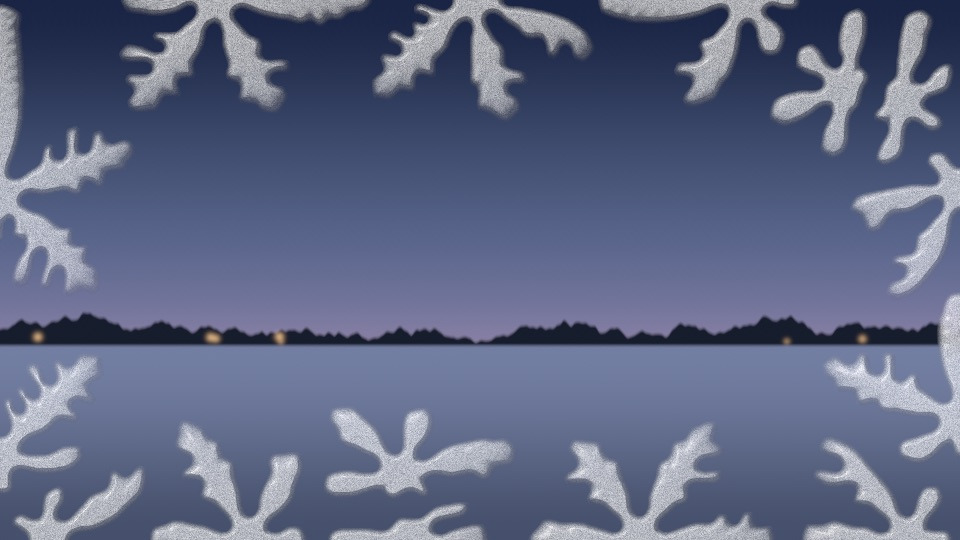

# Growth compared (story 4.5)

Three ways the holofx families grow ice-like or branching figures across a pane, compared on look, cost and memory. All are "grow once, reveal by threshold" or close to it. Numbers are from each family's own measurements on the same Apple M1 Max.

|                      | Phase field (this family)                                                                                          | Shortest-path tree (Storm Temple)                                                                       | Authored crystal field (Water Temple)                                                  |
| -------------------- | ------------------------------------------------------------------------------------------------------------------ | ------------------------------------------------------------------------------------------------------- | -------------------------------------------------------------------------------------- |
| Effect               | [`frost-creep`](../../src/effects/frost-creep/notes.md), [`frost-text`](../../src/effects/frost-text/notes.md)     | `lichtenberg`                                                                                           | `frost-melt`                                                                           |
| Mechanism            | Kobayashi's phase field: latent heat, anisotropy and interface noise grow dendrites                                | Dijkstra over random log-normal cell costs (first-passage percolation)                                  | A six-armed star with side branches, drawn per tile, and a coverage that approaches it |
| Where it runs        | GPU compute, a few steps a frame                                                                                   | CPU, once per figure                                                                                    | GPU, two render passes a frame                                                         |
| Growth cost          | 0.06 ms a step at 1080p (a 960 × 540 grid), about 5,000 steps a pane, spread over the freeze: about 0.3 ms a frame | 80 ms at 480 × 270 on the main thread, once per figure (a dropped frame)                                | Part of the frame cost                                                                 |
| Frame cost, 1080p    | 0.6 ms on Dawn once grown, 1.59 ms in Chrome                                                                       | 1.2 to 1.5 ms in Chrome (HUD)                                                                           | 0.59 ms on Dawn (conservative)                                                         |
| Memory               | About 25 MB at 1080p: two f32 states of 16 bytes a cell, seeds and arrival in half floats                          | Half a megabyte on the GPU (an `rg16float` arrival and flow), plus the CPU's typed arrays while growing | A ping-pong field of at most 1,024 × 256 and a cached backdrop                         |
| Scrub back and forth | Yes, free: a threshold on arrival                                                                                  | Yes, free                                                                                               | No: coverage is state, so it melts forwards only                                       |
| Thaws                | By reversing the reveal: the last ice to freeze thaws first                                                        | By reversing the reveal                                                                                 | Yes, into beads of water that run down: the only one of the three with meltwater       |

## Look

**Phase field.** Crystals branch the way dendrites do: arms in the crystal's six directions, side branches from the interface noise, and thin arms where the latent heat is high. They nucleate where the pane is cold and stop where the room keeps it warm. Each crystal is different and points its own way. The limit is resolution. Arms are about six cells wide, so at two CSS pixels a cell they are twelve pixels across, coarser than frost on real glass. Crowded crystals stay small, compact blobs, so a pane needs few nuclei.

**Shortest-path tree.** A fractal tree, with trunks that thicken by the flow through them. It reads as lightning, a crack or roots, never as ice: there is no crystal anisotropy, so nothing grows in six directions or with regular side branches. It is the right tool for cracks (this family's story 5.2) and the wrong one for frost.

**Authored crystal field.** Six-armed stars, drawn and tiled, read at once as "snowflakes on glass", more icon than frost. The stars sit on a regular lattice: a dot lattice to the pattern guidance. This family's pattern analyser cannot measure that, because its regularity measure does not tell rows of dots from scattered blobs. It is the cheapest per frame and the only one that melts into water.

## Which to use

- **Frost that grows over a page, by time or by scroll, and thaws back:** the phase field. It costs the most memory, about 25 MB at 1080p, and is the only one whose shapes come from the physics. Growing a little a frame keeps it inside Tier A, where the CPU tree drops a frame per figure.
- **Cracks, lightning and roots:** the shortest-path tree. It is cheap on the GPU, but the CPU growth should move to a worker before a page grows figures often.
- **A fixed frosty look that melts into water:** the authored field, kept small or dim, since a lattice of stars over a large area is the pattern the guidance warns about.

The phase field's grower goes into the temple core in story 9.6.
